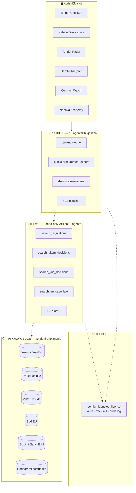
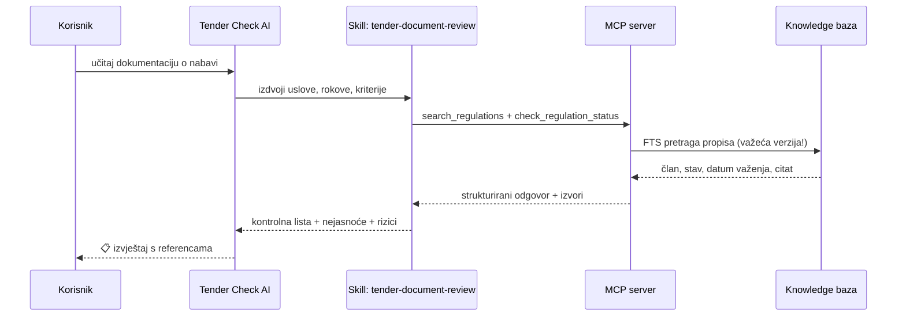
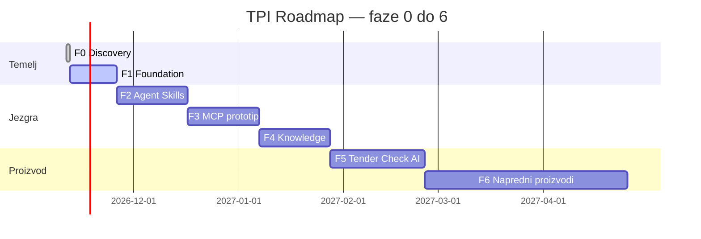

<div align="center">

# 🏛️ Temporis Procurement Intelligence (TPI)

**Modularni AI ekosistem za javnu nabavu u Republici Hrvatskoj**

*Vještine · MCP server · Aplikacije · Znanje s citatima*

[](./ROADMAP.md)
[)
[](#-tpi-agent-skills--16-modula)
[](#-tpi-apps--6-poslovnih-alata)
[](#-tpi-mcp--standardizirani-pristup-znanju)
[](./tests/smoke.test.mjs)

**Nosilac:** Temporis savjetovanje d.o.o. · **Stručna osnova:** Bilten javne nabave (BJN) — korištenje uz dozvolu ✅
> Status: FAZA 2 – prva 3 skilla gotova i testirana. Faza 1 foundation završen (`npm test` zelen).

[🚀 Brzi start](#-brzi-start) · [📖 Dokumentacija](#-dokumentacija) · [🗺️ Roadmap](./ROADMAP.md) · [📊 Status](./PROJECT_STATUS.md) · [⚖️ Pravna osnova](./docs/legal-and-data-rights.md)

</div>

---

## 📌 Šta je TPI?

TPI **nije chatbot**. To je platforma od 6 slojeva u kojoj svaki AI odgovor nosi:

> **izvor · član/stav/tačku · datum i status važenja · jurisdikciju · nivo pouzdanosti**

Ako izvora nema — zaključka nema. AI analiza nikad nije pravno mišljenje niti zamjena za stručnu odgovornost.

<details>
<summary><b>👥 Kome je namijenjen? (klikni)</b></summary>

| Korisnik | Šta dobija |
|---|---|
| 🏢 **Naručitelji** | Ispravna dokumentacija, hodogrami postupaka, kontrola rokova, registar ugovora |
| 📦 **Ponuditelji** | Radar prilika, provjera ponude prije predaje, ESPD pomoć, pravna zaštita |
| ⚖️ **Pravnici** | DKOM/VUS/Sud EU praksa s filterima, poređenje s propisima, nacrti žalbi |
| 🎓 **Certificirani stručnjaci** | Edukacija, simulacije postupaka, testovi znanja |
| 💼 **Konsultanti** | Workspace za cijeli ciklus, izvještaji, analiza rizika |

</details>

---

## 🏗️ Arhitektura sustava



### Tok podataka kroz primjer: analiza tendera 📄➡️✅



---

## 🧠 TPI Agent Skills — 16 modula

> Format: OpenCode-kompatibilan `SKILL.md` · `name == direktorij` · opis 1–1024 znaka · svaki skill: pravila + ulazi + izvori + primjeri + testovi

| # | Skill | Namjena |
|---|---|---|
| 1 | `bjn-knowledge` | Pristup stručnom znanju BJN-a (uz licencu) |
| 2 | `public-procurement-expert` | Opći ekspert za cijeli ciklus nabave |
| 3 | `procurement-law-research` | Istraživanje propisa s citatima i važenjem |
| 4 | `dkom-case-analysis` | Analiza odluka DKOM-a i obrazaca iz prakse |
| 5 | `vus-case-analysis` | Analiza presuda Visokog upravnog suda |
| 6 | `eu-procurement-law` | Pravo EU + praksa Suda EU |
| 7 | `tender-document-review` | Pregled dokumentacije o nabavi |
| 8 | `technical-specification-audit` | Revizija tehničkih specifikacija (diskriminatorni uslovi) |
| 9 | `espd-compliance-check` | Provjera ESPD obrasca |
| 10 | `bid-compliance-review` | Kontrolna lista ponude prije predaje |
| 11 | `procurement-appeal-drafting` | Pomoć pri nacrtu žalbe / prigovora |
| 12 | `procurement-deadline-tracker` | Praćenje rokova postupka |
| 13 | `contract-management-review` | Pregled ugovora, aneksa, garancija |
| 14 | `procurement-risk-assessment` | Procjena rizika (korekcije, sukob interesa) |
| 15 | `procurement-report-generator` | Strukturirani izvještaji s referencama |
| 16 | `tender-opportunity-monitor` | Filtriranje prilika (CPV, vrijednost, lokacija, rok) |

---

## 🔌 TPI MCP — standardizirani pristup znanju

Prva verzija je **read-only** — nijedan alat ne mijenja podatke.

| Alat | Šta vraća |
|---|---|
| `search_regulations` | Propise s članom, datumom i statusom važenja |
| `search_dkom_decisions` | Odluke DKOM-a po ključnim riječima i filterima |
| `search_vus_decisions` | Presude VUS-a |
| `search_eu_case_law` | Presude Suda EU + stručne materijale |
| `search_expert_articles` | Stručne članke |
| `search_bjn_knowledge` | Mrežu znanja BJN-a ✅ *(uz dozvolu)* |
| `get_procedure_workflow` | Hodogram postupka korak-po-korak |
| `analyze_procurement_question` | Strukturirani odgovor s citatima i nivoom pouzdanosti |
| `check_regulation_status` | Je li propis važeći ili historijski |

**Zaštita svakog poziva:** autentifikacija · autorizacija · kontrola licence · rate-limit · audit log · validacija ulaza (zod) · verzioniranje.

---

## 📦 TPI Apps — 6 poslovnih alata

| Aplikacija | Faza ciklusa nabave | Status |
|---|---|---|
| 🔍 **Tender Check AI** | Pregled dokumentacije prije objave/ponude | 📋 Faza 5 |
| 🗂️ **Nabava Workspace** | Projekti · dokumenti · evaluacija · ugovori · aneksi | 📋 Faza 6 |
| 📡 **Tender Radar** | CPV · predmet · lokacija · vrijednost · rokovi · obavijesti | 📋 Faza 6 |
| ⚖️ **DKOM Analyzer** | Obrasci iz prakse + poređenje s propisima i sudskom praksom | 📋 Faza 6 |
| 📜 **Contract Watch** | Rokovi · izmjene · garancije · rizici · izvještaji | 📋 Faza 6 |
| 🎓 **Nabava Academy** | Vodiči · lekcije · testovi · simulacije postupaka | 📋 Faza 6 |



---

## 🛡️ Pravila stručne i pravne pouzdanosti

Svaki AI modul **mora**:

1. 🏷️ Razlikovati zakon, podzakonski akt, sudsku odluku i stručni komentar
2. 📎 Navesti konkretan izvor
3. 📖 Navesti član, stav i tačku kad su dostupni
4. 📅 Navesti datum i status važenja propisa
5. 🕰️ Razlikovati važeće i historijske verzije
6. 🚫 Ne predstavljati komentar kao zakon
7. 🚫 Ne izmišljati odluke, citate ili reference
8. ⚠️ Označiti kad izvor nije dostupan + iskazati nivo pouzdanosti
9. 👩‍⚖️ Preporučiti stručnu provjeru kad je potrebna

> Testovi padaju ako AI izmisli pravnu odredbu, sudsku odluku, koristi zastarjeli propis kao važeći ili miješa jurisdikcije.

---

## ⚖️ Licenca i prava na podatke

[](./LICENSE)

- **Kod i dokumentacija:** [MIT](./LICENSE) — slobodno korištenje uz atribuciju.
- **BJN stručni sadržaj:** koristi se **uz dozvolu** (evidentirano 2026-11-11) — uz obaveznu atribuciju izvora.
- **Javni izvori** (Narodne novine, EUR-Lex, objavljene odluke DKOM/VUS): koriste se prema njihovim uslovima, uvijek s citatom.
- Detalji: [`docs/legal-and-data-rights.md`](./docs/legal-and-data-rights.md)

---

## 🚀 Brzi start

```bash
git clone https://github.com/xnet-ba/temporis-procurement-intelligence
cd temporis-procurement-intelligence
node tests/smoke.test.mjs   # provjera strukture, nula zavisnosti
```

Očekivano: `TPI smoke: OK (22 staze + 16 skillova)` ✅

## 📖 Dokumentacija

| Dokument | Sadržaj |
|---|---|
| [vision.md](./docs/vision.md) | Vizija i korisnici |
| [architecture.md](./docs/architecture.md) | Slojevi, tehnologije, granice |
| [research.md](./docs/research.md) | Potvrđeno / moguće / pretpostavke / pitanja |
| [product-modules.md](./docs/product-modules.md) | Svih 9 modula ukratko |
| [legal-and-data-rights.md](./docs/legal-and-data-rights.md) | Dozvole i obim |
| [security.md](./docs/security.md) | Sigurnosna pravila |
| [decisions/](./docs/decisions/) | ADR-001 monorepo · ADR-002 MCP jezik · ADR-003 pohrana |

---

<div align="center">

**Temporis Procurement Intelligence** · Faza 0 · Novembar 2026

⭐ Ako pratiš projekat — vrati se na Fazu 1: prva 3 skilla + MCP prototip.

</div>
